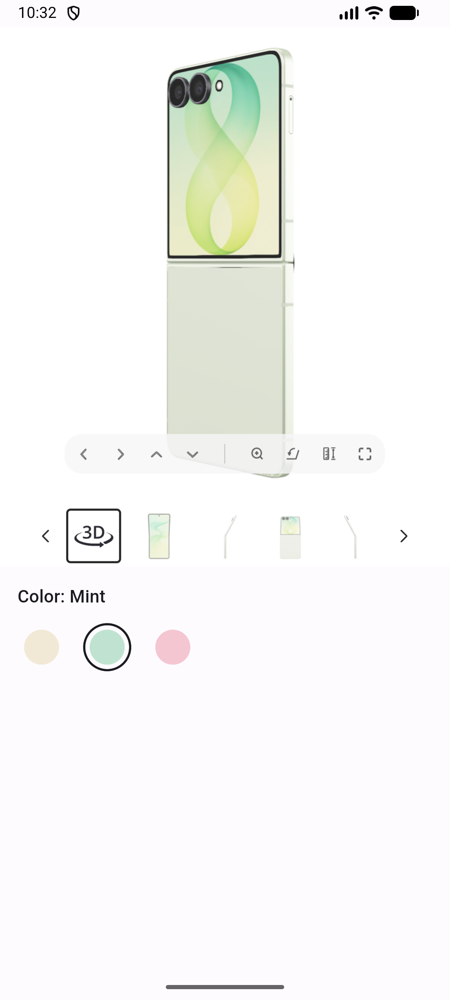

# Binkies 3D viewer in a Flutter app

This example shows how to put the Binkies 3D viewer on a product screen of a Flutter app (Android and iOS).
It is the Flutter version of the Kotlin example and looks and behaves the same.
The viewer is a web page that runs inside a `WebView` ([webview_flutter](https://pub.dev/packages/webview_flutter)). The app and the page talk to each other through a small bridge:

- The app tells the page what to show, e.g. which product (`window.binkies.setSettings(...)`).
- The page asks the app for these settings when it starts, tells it whether the product has a 3D model, and reports its errors (`BinkiesNative.postMessage(...)`).



| File                                                                                                     | What it is                                                                                 |
| -------------------------------------------------------------------------------------------------------- | ------------------------------------------------------------------------------------------ |
| [`lib/binkies_viewer.dart`](lib/binkies_viewer.dart)                                                     | The reusable part: the `BinkiesViewer` widget, `BinkiesSettings` and `BinkiesWebViewHost`. |
| [`lib/main.dart`](lib/main.dart)                                                                         | Only the demo around it: `ProductScreen` and `ColorSelector`.                              |
| [`android/.../MainActivity.kt`](android/app/src/main/kotlin/com/example/flutter_example/MainActivity.kt) | `BinkiesWebViewPlugin` for Android: pauses the WebView while the app is in the background. |

iOS needs no native code.

## Run the example

1. Install [Flutter](https://docs.flutter.dev/get-started/install) (3.47 or newer).
2. Connect an Android device or start an emulator, then run `flutter run` in this folder. iOS needs a Mac with Xcode.
3. Pick a color: Cream and Mint have a 3D model and the viewer slides open. Pink has no model, so the viewer stays collapsed and the label shows "(no 3D)".

## Add it to your app

1. Add the packages:

   ```sh
   flutter pub add webview_flutter webview_flutter_android webview_flutter_wkwebview
   ```

2. Android: add the internet permission to `android/app/src/main/AndroidManifest.xml` (Flutter only adds it to debug builds):

   ```xml
   <uses-permission android:name="android.permission.INTERNET" />
   ```

3. Android: copy `BinkiesWebViewPlugin` into your `MainActivity.kt`, and register it the same way (`configureFlutterEngine`).

4. Copy `lib/binkies_viewer.dart`, and set `viewerUrl` to the viewer page you got from Binkies.

5. Use it on your product screen:

   ```dart
   // null until the page answers, then true (has 3D) or false (no 3D)
   bool? visible;

   BinkiesViewer(
     settings: BinkiesSettings(product: productId), // Binkies content id of the selected variant
     visible: visible == true,
     onVisibilityChange: (value) => setState(() => visible = value),
     onError: (message) {}, // optional, e.g. forward to your crash reporting
   )
   ```

   When the settings change (e.g. another `productId`), the viewer updates without reloading the page.
   Keep `visible` in your screen state if other UI depends on it, e.g. a "3D" badge.

That's all. You don't need to wait for the page or keep track of what it already got: `BinkiesViewer` sends the settings when the page asks for them, and again whenever they change.

## How it works

```
App                                              Page (WebView)
 │  loadRequest(viewerUrl)                         │
 │ ──────────────────────────────────────────────▶ │
 │                  {"type":"setSettings"}         │  window.binkies is ready
 │ ◀────────────────────────────────────────────── │
 │  window.binkies.setSettings({all settings})     │
 │ ──────────────────────────────────────────────▶ │  starts loading the product
 │                  {"type":"show"} or "hide"      │
 │ ◀────────────────────────────────────────────── │
 │  window.binkies.setSettings({all settings})     │  user picks another variant
 │ ──────────────────────────────────────────────▶ │
 │                  {"type":"show"} or "hide"      │  only if it changed
 │ ◀────────────────────────────────────────────── │
 │                {"type":"error", ...}            │  whenever the page logs an error
 │ ◀────────────────────────────────────────────── │
```

### Messages from the page

The page calls `window.BinkiesNative.postMessage(json)`. The app adds that channel with `addJavaScriptChannel` **before** `loadRequest`, because the page posts as soon as it starts (it asks for its settings right away).

| Message                                          | Meaning                                                                                                                                                                             | What the app does                                                               |
| ------------------------------------------------ | ----------------------------------------------------------------------------------------------------------------------------------------------------------------------------------- | ------------------------------------------------------------------------------- |
| `{"type":"setSettings"}`                         | The page is ready for its settings. Sent once per page load, as soon as the page starts.                                                                                            | Sends the current settings.                                                     |
| `{"type":"show"}`                                | The selected product's 3D model has loaded.                                                                                                                                         | Expands the viewer.                                                             |
| `{"type":"hide"}`                                | The selected product has no 3D model, or the device can't render 3D (no WebGL2).                                                                                                    | Collapses the viewer.                                                           |
| `{"type":"error","message":"...","stack":"..."}` | The page logged an error: `console.error`, an uncaught error, an unhandled promise rejection or a failed script/image load. `stack` is only there when there was an `Error` object. | Prints it with `debugPrint` (`[Binkies] page error: ...`), and calls `onError`. |

`show` and `hide` are only sent when the visibility changes. Switching from Cream to Mint sends nothing, because both have 3D.
The page remembers the answer per product, so switching back to a product answers right away.

### Settings sent to the page

`BinkiesViewer` always sends all settings, never only the changed ones: when the page asks for them (`setSettings`), and whenever `settings` changes (compared by their JSON, so only real changes count). It doesn't need to know whether the page is loaded: until the page is ready, `window.binkies` doesn't exist and the call (`window.binkies?.setSettings(...)`) does nothing. The page then asks for the current settings. If the page reloads, it asks again.

| `BinkiesSettings`         | Page setting                       | Type                                             | Default             | Description                                |
| ------------------------- | ---------------------------------- | ------------------------------------------------ | ------------------- | ------------------------------------------ |
| `product`                 | `product`                          | `String`                                         | required            | Binkies content id of the product to show. |
| `thumbnailsPlacement`     | `gallery.thumbnails.placement`     | `ThumbnailsPlacement`: `bottom`, `left`, `right` | `bottom`            | Where the thumbnail strip is placed.       |
| `thumbnailsSelectedColor` | `gallery.thumbnails.selectedColor` | Flutter `Color`                                  | `Color(0xFF262626)` | Border color of the selected thumbnail.    |

Because of the enum and the `Color` type, the app can't send an invalid placement or color. The page still validates the settings strictly: unknown keys and invalid values are rejected, and the previous settings stay in place.
The app wraps every `setSettings` call in `try { ... } catch (error) { console.error(error) }`, so the page sends invalid settings back as an `error` message, which ends up in `onError`.

To use a new setting of the page, add a field with a default value to `BinkiesSettings` and put it into `toJson()`.

## Things to keep in mind

- **Don't remove the WebView to hide it.** A WebView that isn't shown pauses the page, so the next model never finishes loading and `show` never arrives. `BinkiesViewer` instead animates the height of a clipping box around it. The WebView itself always keeps its full height (`OverflowBox` pinned to the top), so the page is never resized while it opens or closes.
- **Pausing in the background.** On Android, `BinkiesViewer` pauses the WebView (`WebView.onPause()`) when the app goes to the background, so the 3D rendering stops. webview_flutter has no API for that, so `BinkiesWebViewPlugin` does it natively on the WebView that webview_flutter created. iOS suspends the WebView on its own.
- **Rotation keeps the page.** Flutter keeps the widget (and the WebView) on rotation, so the page doesn't reload.
- **Viewer size.** The example uses the full width and a 5:6 aspect ratio (`maxWidth * 1.2`), which fits the model with the thumbnails below it. Change `viewerHeight` to fit your layout.

## Debugging

- Debug builds make the page inspectable: `chrome://inspect` in desktop Chrome for Android, Safari's Web Inspector for iOS.
- Bridge messages and page errors are printed with `debugPrint` and a `[Binkies]` prefix: `flutter logs`, or `adb logcat -s flutter` on Android.
- On the page you can call `window.binkies.setSettings({...})` from the DevTools console and read the current settings from `window.binkies.settings`.
